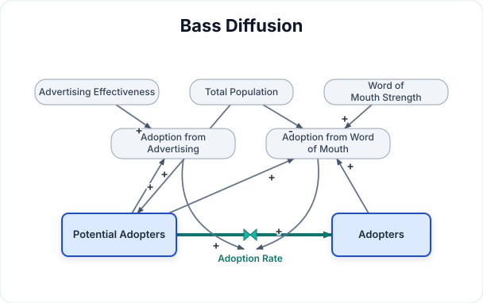

# vensim-ple-mcp

An MCP server that lets Claude (or any MCP client) build, inspect, and **simulate** Vensim system dynamics models, built for **Vensim PLE on macOS**.

Vensim PLE has no scripting interface, DLL, or batch mode. This server works on the `.mdl` text file directly and runs simulations through [PySD](https://github.com/SDXorg/pysd), so an assistant can answer questions like "what happens to peak adoption if word of mouth doubles?" without Vensim DSS. PLE stays the place you open the model, run Check Model and Units Check, and present it.



## Tools

| Tool | What it does |
|---|---|
| `list_model_parameters` | Constants with their current values, other variables, time settings |
| `run_vensim_model` | Simulate with optional constant overrides; returns per-variable summaries (initial, final, min/max and when) and a downsampled series; can save full results to CSV |
| `sweep_model_parameter` | Run once per value of one constant and compare outcomes |
| `generate_vensim_model` | Write a `.mdl` (equations and laid-out diagram) from a JSON spec |
| `inspect_vensim_model` | Read equations, diagram objects, arrows, and views |
| `validate_vensim_model` | Static audit: diagram overlaps, crossing links, variables missing from the diagram |
| `render_vensim_preview` | SVG preview drawn from the model's own diagram records |
| `open_vensim_model` | Open the model in the installed Vensim app |
| `vensim_doctor` | Detect the local Vensim edition and what it supports |
| `create_vensim_dss_script` | Batch script for Vensim DSS only |

Overrides apply to one run only; the `.mdl` file is never modified by simulation. PySD translations are cached in `~/.cache/vensim-ple-mcp` (override with `VENSIM_PLE_MCP_CACHE`), so no extra files appear next to your model.

## Setup

Requires Python 3.10+ and [uv](https://docs.astral.sh/uv/).

```bash
git clone https://github.com/YamKabakov/vensim-ple-mcp.git
cd vensim-ple-mcp
uv sync
uv run python -m unittest discover tests
```

Add it to Claude Desktop (`claude_desktop_config.json`):

```json
{
  "mcpServers": {
    "vensim": {
      "command": "uv",
      "args": ["--directory", "/absolute/path/to/vensim-ple-mcp", "run", "vensim-ple-mcp-server"]
    }
  }
}
```

Or Claude Code: `claude mcp add vensim -- uv --directory /absolute/path/to/vensim-ple-mcp run vensim-ple-mcp-server`

## Command line

```bash
uv run vensim-ple-mcp params examples/bass_diffusion.mdl
uv run vensim-ple-mcp run examples/bass_diffusion.mdl --set "Word of Mouth Strength=0.5" --var Adopters --csv out.csv
uv run vensim-ple-mcp sweep examples/bass_diffusion.mdl "Word of Mouth Strength" 0.2 0.38 0.6 --var "Adoption Rate"
uv run vensim-ple-mcp generate examples/bass_diffusion.json -o examples/bass_diffusion.mdl
uv run vensim-ple-mcp render examples/bass_diffusion.mdl -o examples/bass_diffusion.svg
```

## Limits

- Simulation covers what PySD supports, which is most standard Vensim functions; see the [PySD docs](https://pysd.readthedocs.io/) for exceptions. Vensim remains the authority on Model Check and Units Check.
- The JSON spec supports stocks, flows, auxiliaries, and constants. No lookups, subscripts, or multiple views yet.
- There is no tool yet for editing an existing model in place.

## Roadmap

1. Equation-level checks: undefined references, arrows that don't match equations, basic unit consistency
2. Feedback loop detection with reinforcing/balancing labels
3. Editing existing models while preserving the diagram (`set_equation`, `add_variable`, `rename`)
4. Lookups and multiple views in the spec

## Credits

Built on [Cybing521/vensim-mcp](https://github.com/Cybing521/vensim-mcp) (MIT), which provides the `.mdl` generator, diagram layout, parser, SVG renderer, and native Vensim handoff. This project adds PySD simulation, parameter sweeps, and a PLE-focused workflow.

Vensim is a product of Ventana Systems, Inc. This project is not affiliated with Ventana and does not include Vensim.
