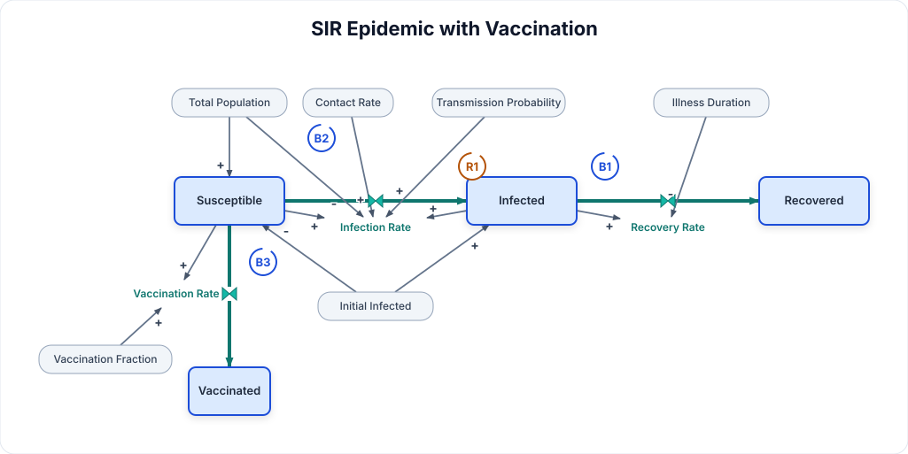

# vensim-ple-mcp

**Build, edit, and simulate Vensim models by talking to Claude.**

Vensim PLE, the free edition, has no scripting interface, DLL, or batch mode. This MCP server works around that: it edits the `.mdl` file directly and keeps the diagram in step, simulates with [PySD](https://github.com/SDXorg/pysd), and on macOS can run the model inside Vensim itself. So you can ask:

> *Add a vaccination flow out of Susceptible at 1% a day. What happens to the peak?*

and get back an updated model and diagram, plus the answer: the outbreak peaks at 57 infected instead of 641.



<sub>[`examples/sir_epidemic.mdl`](examples/sir_epidemic.mdl), drawn by `render_vensim_preview` with loops labelled by `find_feedback_loops`.</sub>

## Tools

### Simulate

| Tool | What it does |
|---|---|
| `list_model_parameters` | Constants with their current values, the other variables, and time settings. Call it first to get exact names |
| `run_vensim_model` | One run, with optional constant overrides. Returns each variable's initial, final, min and max (and when), a downsampled series, and optionally a full CSV |
| `sweep_model_parameter` | One run per value of a constant, with outcomes side by side |
| `plot_vensim_results` | SVG line chart of a run, one panel per unit. Works without Vensim |

Overrides apply to that run only; simulating never changes the `.mdl`.

### Build and edit

| Tool | What it does |
|---|---|
| `generate_vensim_model` | Write a complete `.mdl`, equations and laid-out diagram, from a JSON spec ([example](examples/bass_diffusion.json)) |
| `add_vensim_variable` | Add a constant, auxiliary, stock or flow and draw it with its arrows. A flow gets its valve, pipes and clouds, and is added to its stocks' `INTEG` equations |
| `set_vensim_equation` | Change an equation, unit or note; arrows into the variable are added or removed to match |
| `rename_vensim_variable` | Rename everywhere: its equation, every equation that uses it, and the diagram |
| `delete_vensim_variable` | Remove a variable and its diagram objects. Refuses while other equations still use it |

Edits touch only the equation blocks and diagram records involved, so a model saved by Vensim keeps its formatting, settings and line endings. Each edit keeps the previous version in `~/.cache/vensim-ple-mcp/backups` (or pass `output_path` to write a copy instead). If the model is open in Vensim, close it without saving and reopen it afterwards.

New objects go in free space next to the variables they connect to. When a flow joins a stock that nothing else is attached to yet, that stock moves into line with the other end so the pipe runs straight. Likewise, a constant added before anything used it moves next to its first user.

### Check and explain

| Tool | What it does |
|---|---|
| `validate_vensim_model` | Static audit. **Errors:** undefined variables, unknown functions, algebraic loops, circular initialization. **Warnings:** unit mismatches (including stock and delay-time units), unused constants, arrows that don't match equations, flows piped to a stock but missing from its `INTEG` or wrongly signed, overlaps, crossings. Equation findings also come back as structured `issues`, each naming its variable |
| `find_feedback_loops` | Every feedback loop, labelled reinforcing (R) or balancing (B), with the polarity of each link and the stocks it passes through. With `annotate`, writes link polarities and R1/B1 labels onto the diagram |
| `inspect_vensim_model` | Raw equations, diagram objects, arrows and views |

### Diagram and Vensim

| Tool | What it does |
|---|---|
| `render_vensim_preview` | SVG of the model's own diagram, like the one above |
| `simulate_in_vensim` | Run the model inside Vensim, so its Graph and Table tools have a loaded run (see [below](#simulating-inside-vensim)) |
| `open_vensim_model` | Open the model in Vensim |
| `vensim_doctor` | Which Vensim is installed and what it can automate |
| `create_vensim_dss_script` | Batch `.cmd` script, for Vensim DSS only |

PySD translations are cached in `~/.cache/vensim-ple-mcp` (override with `VENSIM_PLE_MCP_CACHE`), so no extra files appear next to your model.

## Setup

Requires Python 3.10+ and [uv](https://docs.astral.sh/uv/).

```bash
git clone https://github.com/YamKabakov/vensim-ple-mcp.git
cd vensim-ple-mcp
uv sync
```

Vensim itself is optional: everything except `simulate_in_vensim` and `open_vensim_model` works without it.

Add it to Claude Desktop (`claude_desktop_config.json`):

```json
{
  "mcpServers": {
    "vensim": {
      "command": "uv",
      "args": ["--directory", "/absolute/path/to/vensim-ple-mcp", "run", "vensim-ple-mcp-server"]
    }
  }
}
```

Or Claude Code: `claude mcp add vensim -- uv --directory /absolute/path/to/vensim-ple-mcp run vensim-ple-mcp-server`

## Simulating inside Vensim

Vensim's Graph and Table tools only show runs Vensim made itself, so `simulate_in_vensim` has Vensim do the run and saves `<run_name>.vdfx` next to the model.

| Vensim | How | One-time setup |
|---|---|---|
| PLE, PLE Plus, Professional on macOS | Drives the Simulation Control dialog through the accessibility API | In System Settings > Privacy & Security > Accessibility, turn on the app that runs the server (Claude Desktop, Terminal, iTerm, VS Code, ...), then restart it. Without this, the tool returns these steps |
| DSS (macOS or Windows) | Vensim command script | None |
| PLE on Windows | Not automated yet: open the model and click Simulate | None |

On macOS, Vensim stays out of your way. It opens the model in the background and comes forward for about half a second, because it only builds its Simulation menu while active. Then focus goes back to your app while the run finishes. If Vensim wasn't running, it is brought forward once to finish starting up.

It handles Vensim's routine prompts itself:
- switching to a model that is already open
- opening the file rather than an autosave copy
- dismissing failed-autosave notices about other open models
- overwriting an existing run, unless `overwrite` is false

Any other message, such as "Model has errors and cannot be simulated", comes back as the error. Vensim simulates the model as it is open in Vensim, including unsaved changes there.

## Command line

Every tool is also a command:

```bash
uv run vensim-ple-mcp doctor
uv run vensim-ple-mcp params examples/sir_epidemic.mdl
uv run vensim-ple-mcp run examples/sir_epidemic.mdl --set "Vaccination Fraction=0" --var Infected --csv out.csv
uv run vensim-ple-mcp sweep examples/sir_epidemic.mdl "Vaccination Fraction" 0 0.005 0.01 --var Infected
uv run vensim-ple-mcp plot examples/sir_epidemic.mdl -o outbreak.svg --var Infected --var Vaccinated
uv run vensim-ple-mcp validate examples/sir_epidemic.mdl
uv run vensim-ple-mcp loops examples/sir_epidemic.mdl              # --annotate labels the diagram
uv run vensim-ple-mcp render examples/sir_epidemic.mdl -o diagram.svg
uv run vensim-ple-mcp vensim-run examples/sir_epidemic.mdl --run-name baseline

uv run vensim-ple-mcp generate examples/bass_diffusion.json -o model.mdl
uv run vensim-ple-mcp add model.mdl "Churn" "Adopters * 0.05" --unit Person/Year --kind flow --source Adopters
uv run vensim-ple-mcp set model.mdl "Word of Mouth Strength" 0.5
uv run vensim-ple-mcp rename model.mdl "Adopters" "Customers"
uv run vensim-ple-mcp delete model.mdl "Churn"
```

## Examples

| Model | Shows |
|---|---|
| [`sir_epidemic.mdl`](examples/sir_epidemic.mdl) | Three-stock chain with a vaccination branch, and four labelled loops |
| [`bass_diffusion.mdl`](examples/bass_diffusion.mdl) | Product adoption from advertising and word of mouth, generated from [its JSON spec](examples/bass_diffusion.json) |
| [`market_adoption.mdl`](examples/market_adoption.mdl) | One stock with acquisition and churn flows from and to clouds, driven by a campaign budget and word of mouth ([spec](examples/market_adoption.json)) |

## Tests

```bash
uv run python -m unittest discover tests
VENSIM_LIVE=1 uv run python -m unittest tests.test_native_simulate   # also drives a real Vensim
```

## Limits

- Vensim's Check Model and Units Check remain the authority. The unit check here is conservative: it skips what it cannot infer (unfamiliar functions, variables without units), and the only unit aliases it knows are singular and plural time units, such as Month and Months.
- Link polarity assumes variables are positive (constants use their actual sign) and that lookups follow their table's direction. When a sign depends on values, as with an IF THEN ELSE or a lookup that rises then falls, the loop is reported as unknown (U1, ...) with the undetermined links named, rather than guessed.
- Simulation covers what PySD supports, which is most standard Vensim functions; see the [PySD docs](https://pysd.readthedocs.io/) for exceptions.
- The JSON spec covers stocks, flows, auxiliaries and constants: no lookups, subscripts or multiple views yet.
- Editing covers plain equations. Edit subscripted, lookup and data variables in Vensim.
- In a crowded diagram, automatic placement can overlap other objects. It says so when it does; pass `x` and `y`, or drag the object in Vensim.

## Roadmap

1. Loop dominance over time: which loops drive behaviour in each phase of a run
2. Lookups and multiple views in the spec

## Credits

Built on [Cybing521/vensim-mcp](https://github.com/Cybing521/vensim-mcp) (MIT), which provided the original `.mdl` generator, diagram layout, parser, SVG renderer and Vensim launcher. This project adds PySD simulation and sweeps, in-place editing that keeps the diagram, equation and unit checks, feedback loop analysis, and simulation inside Vensim PLE on macOS.

Vensim is a product of Ventana Systems, Inc. This project is not affiliated with Ventana and does not include Vensim.
